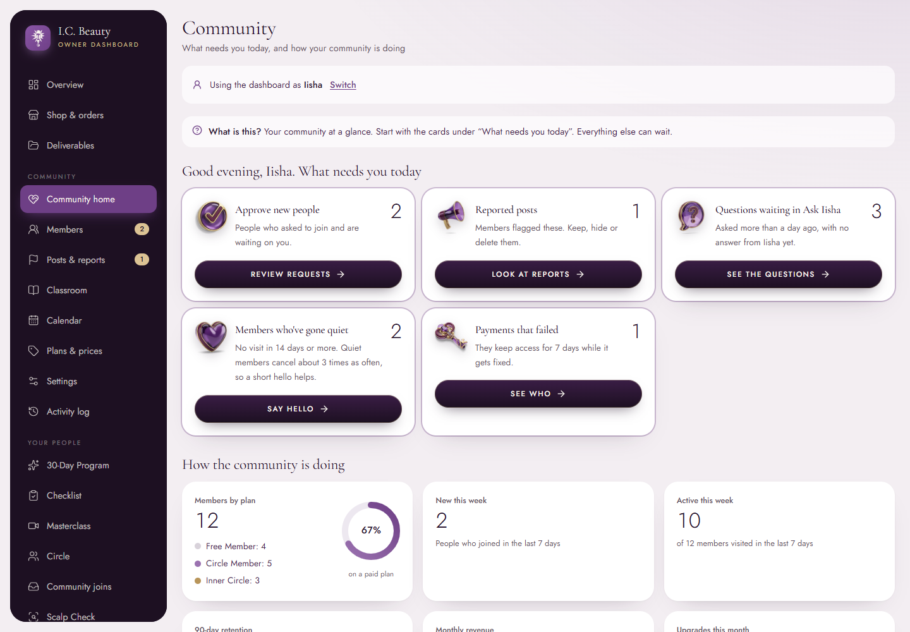
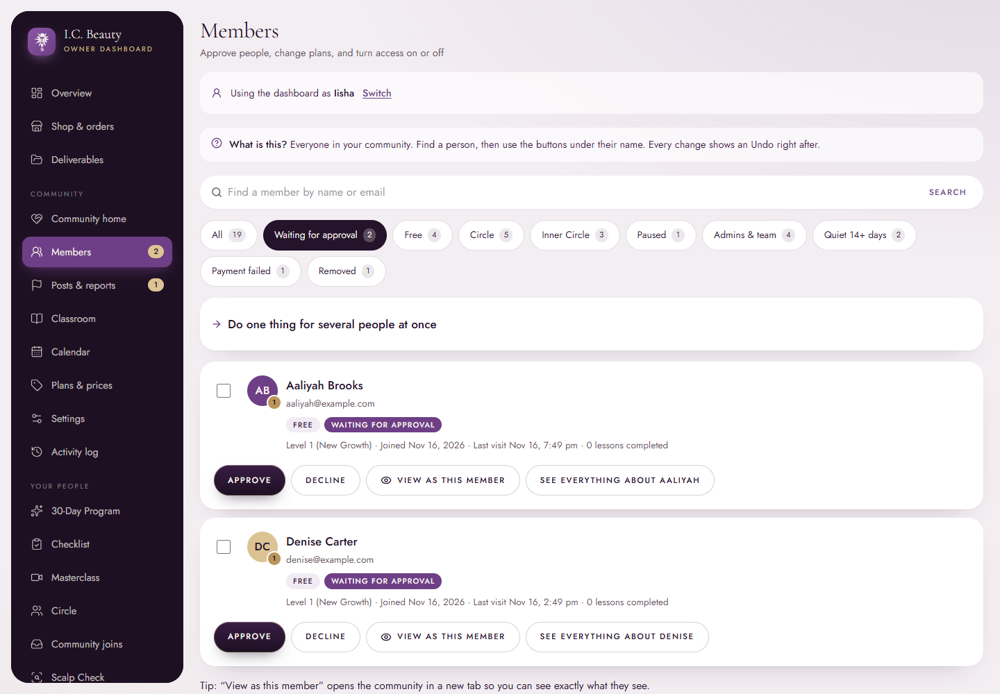
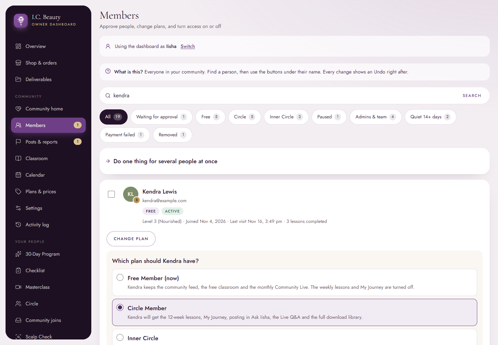
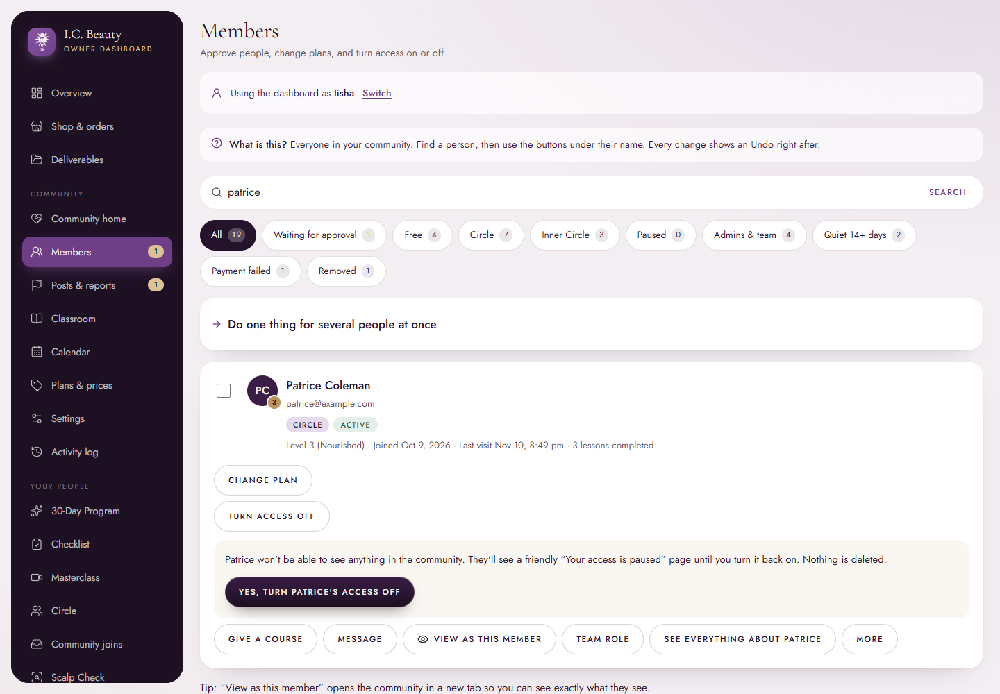
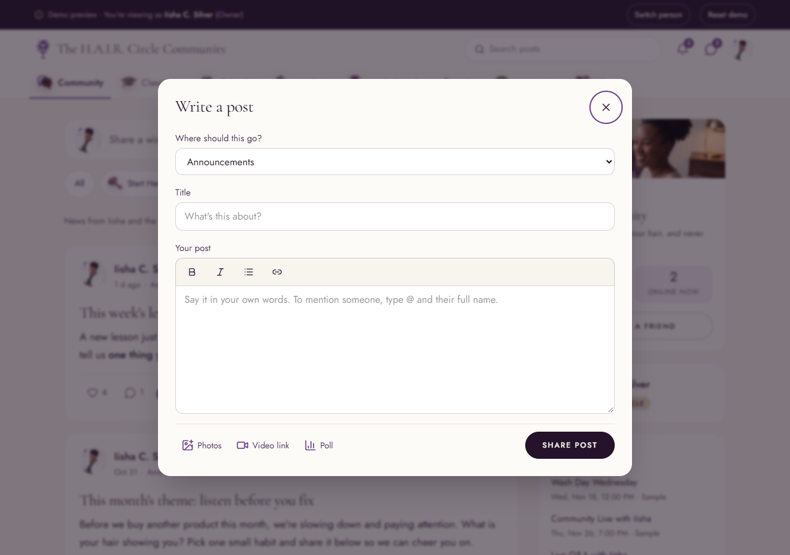
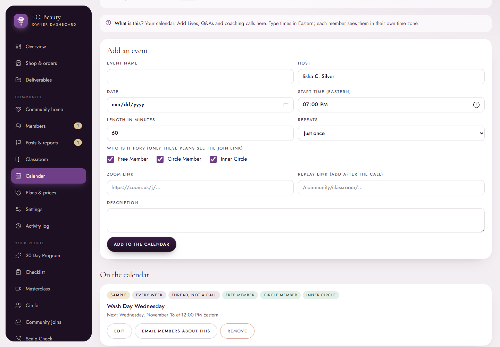
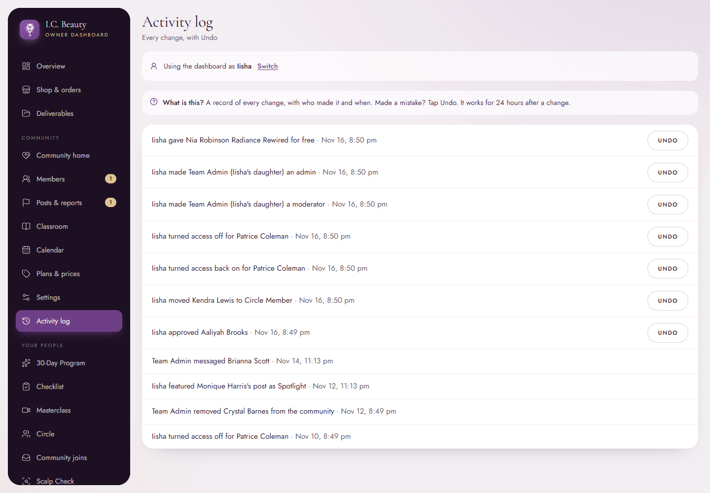

# The H.A.I.R. Circle Community: Owner Guide

For Iisha and her team. Plain English, no tech words. Everything here happens in your **owner dashboard**.

**How to get there:** go to `icbeautyinyou.com/admin`, sign in with the dashboard password, and look for the **Community** group in the menu on the left (on a phone, tap the menu bar at the top).

**The first time each day:** the dashboard asks **"Who's using the dashboard?"** Tap your name. That way every change shows who made it.

**Good to know before you start**

- Nothing you tap here is permanent. After every change a green bar appears with an **Undo** button, and the **Activity log** keeps an Undo for 24 hours.
- While the community is in demo mode, every member is a sample person. Practice as much as you like. You can reset the demo any time (Community → Settings → Reset demo data).
- Not sure what a member sees? Tap **View as this member** on their card. The community opens in a new tab exactly as they see it.

---

## 1. How to approve someone

1. Open **Community → Community home**. Under "What needs you today", tap **Review requests** on the "Approve new people" card. (Or open **Members** and tap **Waiting for approval**.)
2. Read their answers if you like: tap **See everything about …** on their card.
3. Tap **Approve**.

That's it. They are let in and get your welcome message automatically. To say no instead, tap **Decline** and confirm.

## 2. How to move someone to Inner Circle

1. Open **Community → Members**. Type their name in the search box.
2. On their card, tap **Change plan**.
3. Choose **Inner Circle**. The card tells you in plain words what they will get.
4. Want to give it as a gift for a while? Pick a date under **Gift it for free until…**. Leave the date empty to change their plan for good.
5. Tap **Save plan** (the button shows their first name, like “Save Tasha’s plan”).

The same steps move someone to Circle or back to Free.

## 3. How to turn someone's access off (and back on)

1. Open **Community → Members** and find the person.
2. Tap **Turn access off**, then confirm with the **Yes** button under it.

They will see a kind "Your access is paused" page. Nothing of theirs is deleted.

**To turn it back on:** tap the **Paused** filter at the top of Members, find them, and tap **Turn access back on**.

## 4. How to post an announcement

1. Open **Community → Community home**.
2. Under "Quick actions", tap **Post an announcement**. The community opens in a new tab with the writing box ready.
3. Type a title and your message. Make sure the category says **Announcements**.
4. Tap **Share post**.

Want it to stay at the top? Open **Community → Posts & reports**, find your post, and tap **Pin to top**.

## 5. How to add an event

1. Open **Community → Calendar**.
2. In **Add an event**, type the name, pick the date and the start time (in Eastern time), and how long it runs.
3. Under **Who is it for?**, tick the plans that can join. Only those members see the Zoom link.
4. Paste the Zoom link if you have it. You can add it later.
5. Tap **Add to the calendar**.

After the call, open the event, tap **Edit**, and paste the replay link.

## 6. How to undo a mistake

- **Right away:** tap **Undo** in the green bar that appears after any change.
- **Later (up to 24 hours):** open **Community → Activity log**, find the line (for example "Iisha moved Tasha Jones to Inner Circle"), and tap **Undo** next to it.

---

## Where everything lives

| I want to… | Go to |
| --- | --- |
| See what needs me today | Community → Community home |
| Approve, change plans, pause, message a member | Community → Members |
| Handle a reported post, pin or hide a post | Community → Posts & reports |
| Choose who can see a course, add a lesson video | Community → Classroom |
| Add or change a Live or coaching call | Community → Calendar |
| Set prices and what each plan includes | Community → Plans & prices |
| Change the welcome message, questions or rituals | Community → Settings |
| See or undo a change | Community → Activity log |

**A few things only Iisha can do:** make someone an admin or moderator, and remove someone from the team. Everyone else sees those buttons greyed out with "Only Iisha can do this."

**Stuck?** Message Couture House (Azaiah or Fred). Nothing you tap can break the website.
